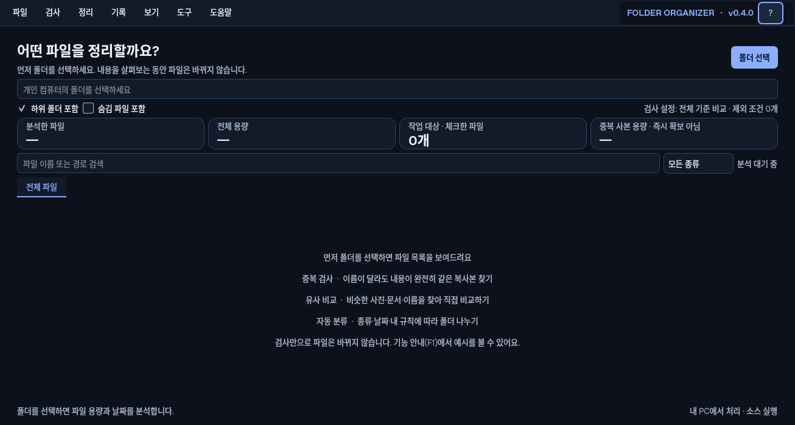
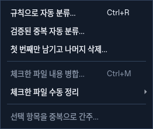
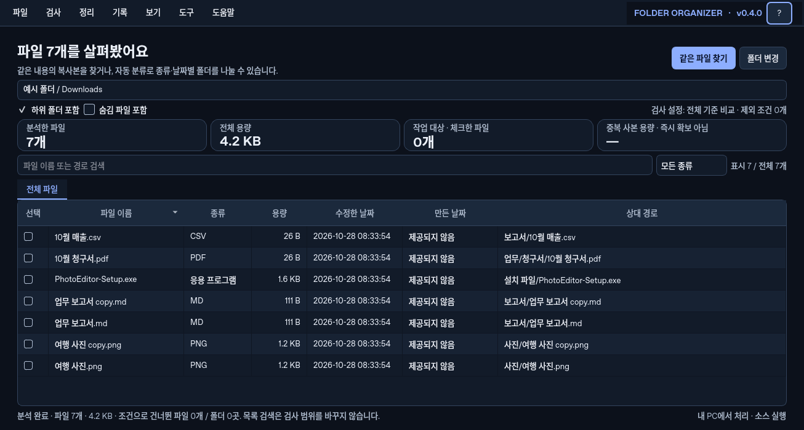
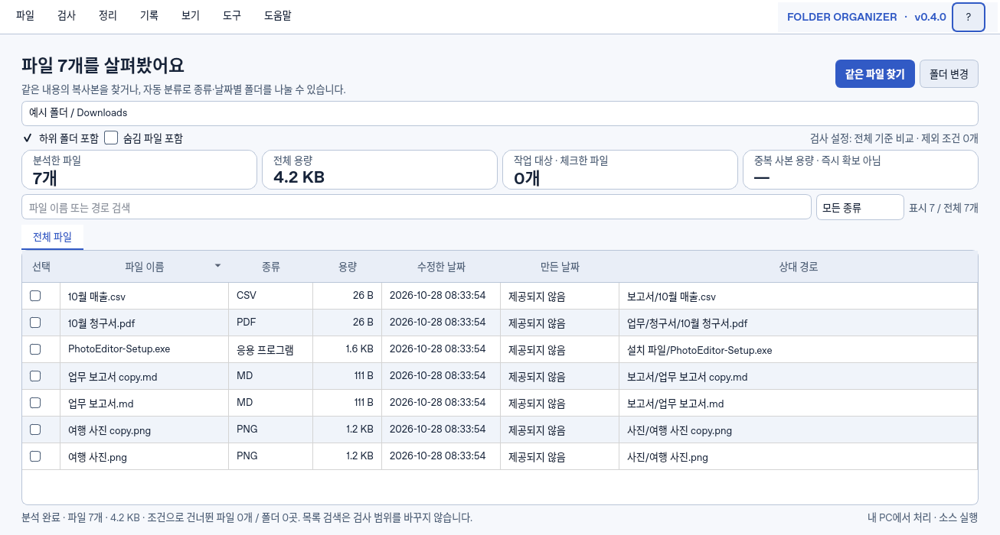
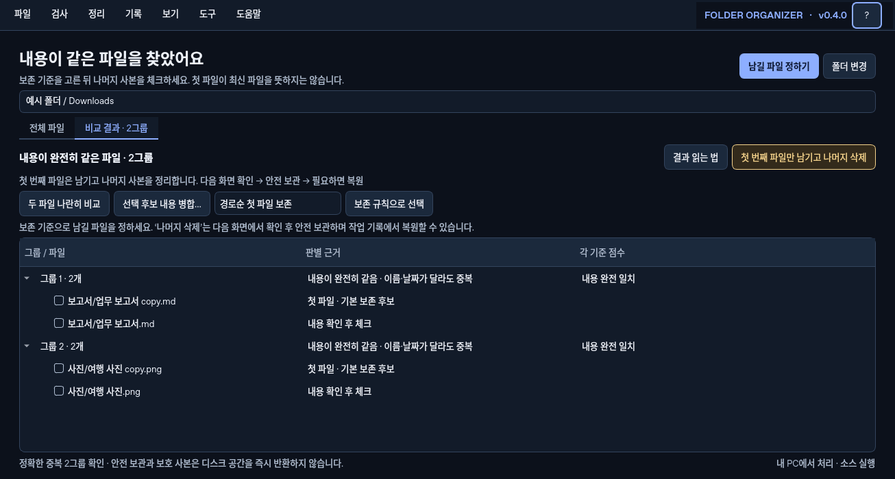
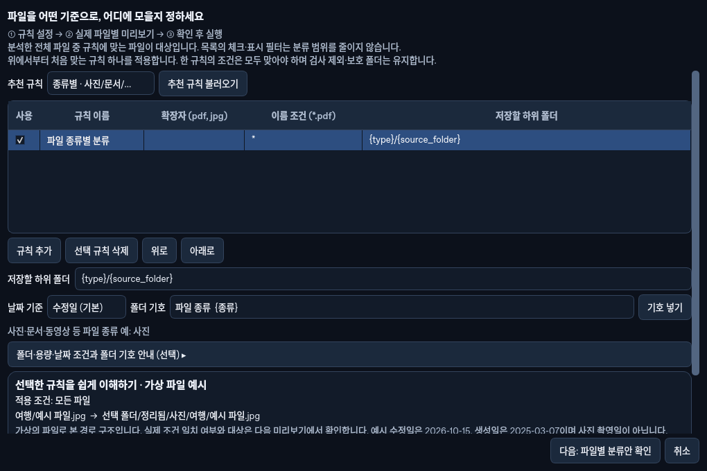
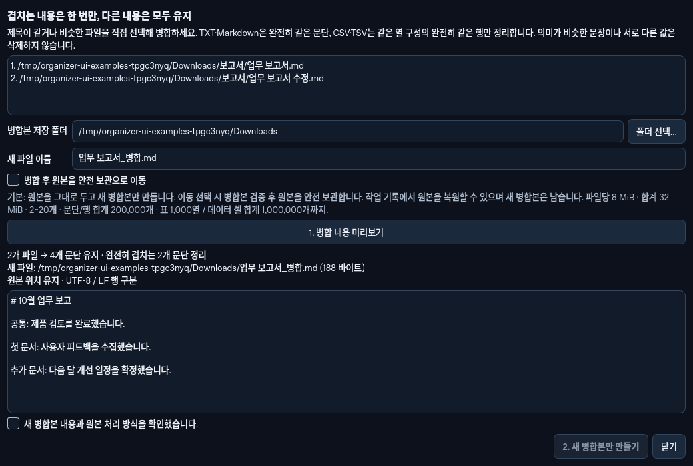
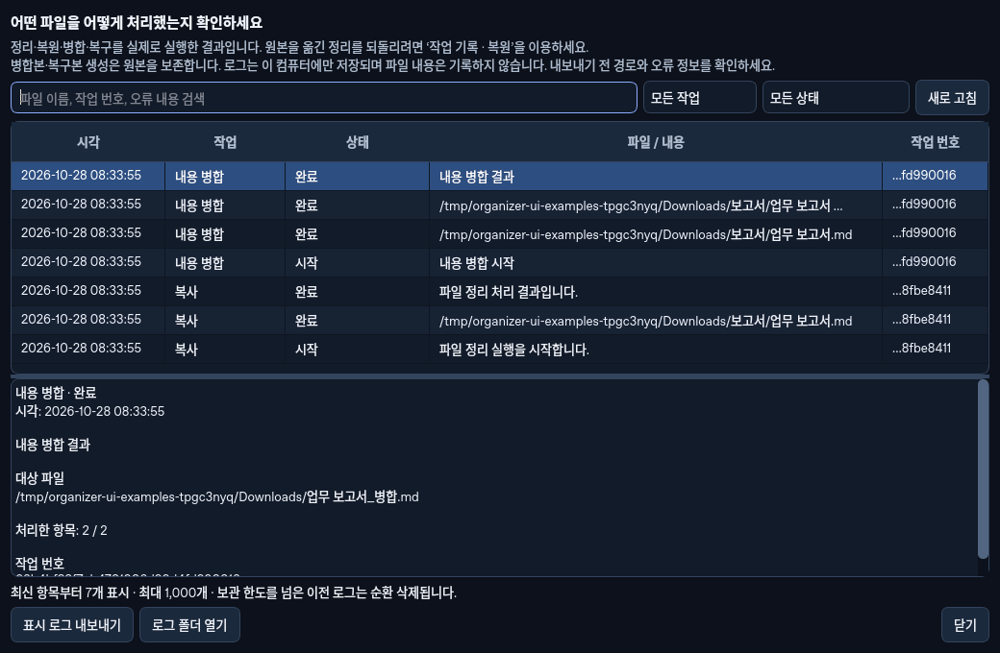
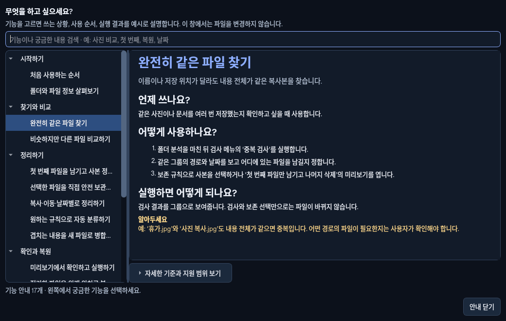

# 화면에서 기능 이해하기

아래 이미지는 개인 자료 대신 임시 예시 파일로 **실제 앱을 실행해 캡처한 화면**입니다. 설치된 사용자 설정과 원본 자료를 사용하지 않았습니다.

## 처음에는 폴더만 선택하세요

폴더를 선택하면 파일별 용량과 날짜를 살펴봅니다. 이 단계에서는 파일이 바뀌지 않습니다. 상단은 현재 상태에 맞춰 다음 작업을 안내합니다. 메인 화면의 버튼을 줄이고 전체 기능을 헤더의 드롭다운 메뉴로 모았습니다. **도움말 또는 F1**은 파일을 바꾸지 않는 설명 창입니다.

| 상단 메뉴 | 찾을 수 있는 기능 |
| --- | --- |
| 파일 | 폴더 선택·다시 분석·목록 선택·위치 열기·목록/분석 보고서 내보내기 |
| 검사 | 완전 중복 검사·유사 비교·검사 설정 |
| 정리 | 규칙 분류·중복 자동 정리·선택 파일 정리·내용 병합·중복으로 간주 |
| 기록 | 실행 로그·작업 기록과 복원·활동 및 진단 로그 |
| 보기 | 다크 모드(기본)·라이트 모드 |
| 도구 | 손상 검사·복구본 만들기·업데이트 확인과 자동 업데이트 설정 |
| 도움말 | 사용 안내·중복과 유사의 차이 |

화면 색은 **보기**에서 바꾸며 선택은 이 컴퓨터에 저장됩니다. 검사·정리 조건과 파일은 바뀌지 않습니다.

정리 기능은 위 메뉴에서 찾을 수 있습니다. 실행 조건이 갖춰지지 않은 항목은 비활성화됩니다.

## 목적에 맞는 기능을 고르세요

| 다크 모드 · 기본 | 라이트 모드 |
| --- | --- |
|  |  |

두 화면은 같은 예시 파일을 다른 색으로 표시한 것입니다. **보기**에서 바꿀 수 있으며 검사 결과와 선택 항목은 그대로 유지됩니다.

| 하고 싶은 일 | 사용할 기능 | 실행 결과 |
| --- | --- | --- |
| 같은 내용을 여러 번 저장했는지 확인 | 검사 → 중복 검사 | 내용이 완전히 같은 파일을 그룹으로 보여줍니다. 검사만으로 변경하지 않습니다. |
| 비슷한 사진이나 문서 버전 비교 | 검사 → 유사 비교 | 직접 확인할 후보를 보여줍니다. 높은 점수는 완전 중복의 뜻이 아닙니다. |
| 종류·날짜·원하는 조건으로 폴더 나누기 | 정리 → 규칙 분류 | 규칙으로 분류안을 만들며 복사가 기본입니다. 분석한 전체 파일 중 조건에 맞는 항목을 사용합니다. |
| 직접 고른 파일을 복사·이동·보관 | 체크 → 아래 정리 방식 → 미리보기 | 파일 목록에서 체크한 항목만 수동 작업 대상으로 사용합니다. |
| 같은 문단·데이터 행을 한 번씩 모으기 | 두 개 이상 체크 → 정리 → 체크한 파일 내용 병합 | 원본을 남기고 새 병합본을 만듭니다. 원본 안전 보관은 별도로 선택합니다. |
| 이전 작업 되돌리기 | 기록 → 작업 기록 · 복원 | 변경되지 않고 충돌하지 않는 파일을 확인해 작업을 되돌립니다. |
| 파일별 실제 처리 결과 찾기 | 기록 → 실행 로그 | 실행 시작·파일별 결과·완료·실패를 검색합니다. 로그 화면은 파일을 복원하지 않습니다. |
| 앱 진행 상황이나 오류 진단 | 기록 → 활동 · 진단 로그 | 검사와 업데이트를 포함한 앱 활동을 설명합니다. |

행을 클릭해 강조하는 것과 **체크 상자를 선택하는 것**은 다릅니다. 체크한 파일은 검색으로 숨겨도 선택이 남습니다. 화면의 ‘숨겨진 파일 포함’ 안내와 미리보기의 전체 대상 목록을 확인하세요.

## 중복 결과에서는 남길 파일을 정하세요

‘남길 파일 정하기’는 보존 규칙에 따라 사본을 체크합니다. 이때도 파일은 바뀌지 않습니다. ‘첫 번째 파일만 남기고 나머지 삭제’는 표시된 첫 파일과 보호 파일을 남기는 **별도의 안전 보관 미리보기**입니다. 첫 번째가 최신 파일이라는 의미는 아닙니다. 안전 보관은 원래 위치에서 옮기는 방식이며 작업 기록에서 복원할 수 있지만 디스크 공간을 즉시 확보하지 않습니다.

같은 결과를 밝은 화면으로 보려면 [라이트 모드 중복 결과](comparison-light.png)를 확인하세요.

비교 탭에서는 결과를 넓게 보여줍니다. 파일 목록의 검색·종류·검사 범위는 ‘전체 파일’ 탭에서 다시 확인할 수 있습니다. 전체 검사 범위와 화면 표시 필터는 다릅니다. 자동 분류와 중복 사본 정리는 체크·화면 필터가 아닌 검사 범위에서 계획을 만듭니다.

## 규칙은 예시를 보며 편집하세요

추천 규칙을 선택하고 이름·확장자·저장할 하위 폴더를 편집합니다. 매핑 기호 선택에서 `{종류}`, `{규칙}`, `{연도}`, `{월}` 등을 넣을 수 있습니다. 예를 들어 `청구서/{연도}/{월}`은 파일 날짜에 맞춰 하위 폴더가 달라집니다. `{수정일:%Y/%m/%d}`처럼 날짜 형식을 직접 지정할 수도 있습니다.

아래 가상 예시가 적용 조건과 예상 경로를 설명합니다. 예시는 파일을 실제로 읽거나 분류한 결과가 아닙니다. 폴더·용량·날짜 조건은 필요할 때 펼칠 수 있으며 접어도 저장된 조건은 유지됩니다. 날짜 기준은 수정일(기본) 또는 생성일입니다. 생성일이 필요한데 운영체제가 제공하지 않으면 해당 파일은 건너뛰고 이유를 알립니다. 사진 촬영일로 대신하지 않습니다.

실제 대상은 다음 미리보기에서 확인합니다. 복사는 원본이 남고, 이동·안전 보관은 원래 위치가 바뀝니다. 자동 분류 실행에는 경로 확인과 체크 확인 절차가 있으며 기존 안전 검증과 복원 기록을 유지합니다.

## 겹치는 내용은 병합 미리보기를 확인하세요

같은 제목의 파일이라도 내용이 같다는 보장은 없습니다. 먼저 비교하고 병합할 파일만 체크합니다. **정리 → 체크한 파일 내용 병합**에서 새 병합본의 이름·위치와 겹치는 부분이 제거된 내용을 확인하세요.

UTF-8 `.txt`·`.md`는 완전히 같은 문단을, 같은 형식·열 제목의 `.csv`·`.tsv`는 모든 셀 값이 같은 행을 한 번씩 남깁니다. 서로 다른 내용과 처음 나타난 순서는 보존합니다. 파일은 2~20개, 각각 8 MiB·전체 32 MiB, 전체 문단·행 200,000개까지입니다. 표는 최대 1,000열·전체 1,000,000셀을 지원하며 셀 내부 줄바꿈도 보존합니다. 문장의 의미·충돌을 판단하는 자동 편집이나 이미지·Office 문서 병합은 지원하지 않습니다.

**새 병합본만 만들기**가 기본입니다. 원본을 다른 곳으로 옮기지 않으려면 이 상태로 실행하세요. **병합 후 원본을 안전 보관으로 이동**을 선택하면 검증된 병합본을 만든 뒤 원본을 보관합니다. 보관을 작업 기록에서 되돌려도 새 병합본은 남습니다. 기존 파일을 덮어쓰지 않으며, 부분 완료·실패가 나오면 병합본과 원본·보관 상태를 결과에서 확인하세요.

## 실행 결과와 복원 기록을 구분하세요

**기록 → 실행 로그**에서 작업 종류·상태를 고르고 파일 이름·작업 ID·오류로 실제 처리 결과를 찾습니다. 로그는 결과를 설명하며 여기서 파일을 복원하지 않습니다. **기록 → 작업 기록 · 복원**에서 원래 폴더의 기록과 보관본을 사용해 되돌립니다.

## 기능별 예시를 검색하세요

기능별 주제에서 ‘언제 쓰나요 → 어떻게 사용하나요 → 실행하면 어떻게 되나요’를 읽을 수 있습니다. ‘사진’, ‘첫 번째’, ‘병합’, ‘생성일’, ‘실행 로그’처럼 궁금한 말로 검색하세요. 자세한 판정 기준은 필요한 경우에 펼칩니다.

작업 기록과 로그의 실제 화면: [작업 기록·복원](history.png), [활동 로그](logs.png). 로그는 한글 설명이 기본이며 지원용 기술 정보는 선택해서 펼칠 수 있습니다. 실제 복원은 작업 기록과 보관본을 사용하고 실행·진단 로그는 결과를 설명합니다.

개발 환경에서 같은 예시 화면을 재생성하려면 `QT_QPA_PLATFORM=offscreen python scripts/capture_ui.py`를 사용합니다. 프로젝트 의존성이 설치되어 있어야 하며 `docs`의 PNG 파일을 갱신합니다.
