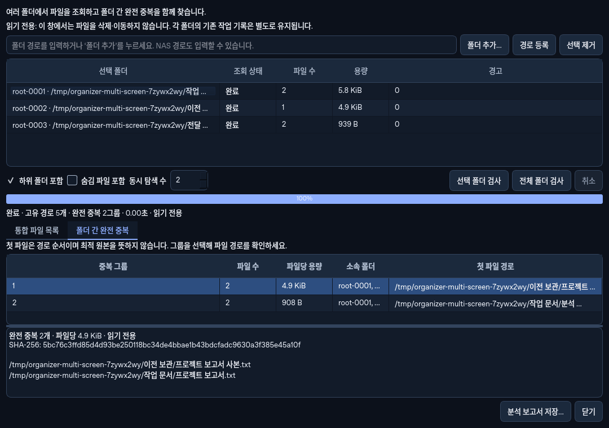

# 여러 폴더 선택·읽기 전용 통합 분석

Python과 Rust 모두 **파일 → 여러 폴더 통합 분석…**에서 엽니다. 기존 단일 폴더의 파일 목록·선택·작업 기록은 그대로 두고, 새 창에서 여러 폴더의 파일과 폴더 간 완전 중복을 함께 확인합니다.



화면은 Linux Qt 환경에서 임시 폴더 3개를 실제 분석한 Python 창입니다. Windows 배포 실행이나 NAS 시험의 증거로 사용하지 않습니다.

## 사용 순서

1. **폴더 추가**로 여러 폴더를 등록합니다. Python은 경로 직접 입력도 지원합니다.
2. 하위 폴더·숨김 여부와 현재 검사 범위를 확인합니다. **전체 폴더 검사** 또는 선택한 폴더만 검사합니다.
3. 폴더별 완료·접근 실패·취소 상태와 통합 파일 목록·완전 중복 그룹을 확인합니다.
4. 필요하면 입력 폴더 밖의 **새 JSON 보고서**로 저장합니다. 기존 파일은 덮어쓰지 않습니다.

최대 64개 폴더, 동시 탐색 상한 1~4개를 지원합니다. 기본 상한은 2개이며 같은 볼륨·NAS 서버 그룹은 순서대로 조회합니다. Windows의 물리 장치 관계가 불명확한 로컬 폴더는 같은 보수적 그룹으로 직렬 처리합니다. Unix의 장치 번호는 논리 볼륨 힌트이며 서로 다른 번호가 실제 물리 디스크의 독립성을 보장하지 않습니다. 전체 내용 검사는 직렬 실행합니다. worker 수를 늘리면 반드시 빨라진다는 의미가 아닙니다.

## 겹친 폴더·파일과 부분 결과

같은 폴더의 중복 입력은 기존 루트에 연결합니다. 상위 폴더와 하위 폴더를 함께 선택하면 각 범위의 상대 경로 제외 규칙을 유지하기 위해 각각 조회하되, 전역 목록과 내용 검사에는 같은 경로를 한 번만 반영합니다. 파일마다 발견된 루트와 상대 경로를 보존합니다. 겹친 조회에서 서로 다른 파일 스냅샷이 발견되면 해당 경로를 제외하고 부분 상태를 표시합니다.

하드링크 경로는 목록에 남지만 같은 물리 파일을 별도의 사본으로 잘못 집계하지 않습니다. 일부 폴더 접근 실패 시 정상 파일의 검증된 그룹은 보여주고 전체 결과는 미완료로 표시합니다. 내용 검사를 취소해도 이미 완료한 파일 목록과 취소된 내용 검사를 구분합니다.

그룹의 첫 파일은 경로 순서의 기준이며 최적 원본이나 삭제할 사본의 판단이 아닙니다. 새 창은 삭제·이동·자동 정리를 제공하지 않습니다. 통합 그룹은 기존 단일 폴더 작업에 필요한 내부 인증 증명을 갖지 않는 별도 자료형입니다. 보고서에서도 `action_authority`는 항상 `false`입니다.

## CLI와 보고서 계약

기존 위치 인자와 단일 폴더 JSON/CSV는 유지합니다. 추가 폴더는 반복하는 `--add-folder`로, 새 보고서는 `--json-multiroot`로 구분합니다.

```powershell
FolderOrganizer.exe --cli "D:\Work" --add-folder "E:\Archive" --duplicates --workers 2 --json-multiroot "C:\Reports\multi.json"
FolderOrganizerRustCLI.exe "D:\Work" --add-folder "E:\Archive" --duplicates --workers 2 --json-multiroot "C:\Reports\multi.json"
```

`--duplicates`를 생략하면 파일 목록만 조회하며 내용을 해시하지 않습니다. 다중 폴더 모드에서 `--similar`와 기존 단일 폴더 내보내기 옵션을 혼합하면 명시적 오류를 반환합니다. `--json-multiroot`만 지정해 단일 폴더를 새 형식으로 내보낼 수도 있습니다. 전체 완료는 종료 코드 0, 부분·취소·Python 입력 오류는 2입니다. 기존 Rust CLI의 잘못된 옵션 등 오류는 기존과 같이 1입니다.

새 스키마는 `folder-organizer.multiroot.v1`입니다. 기존 `folder-organizer.common.v1`을 대체하지 않습니다.

| 필드 | 의미 |
| --- | --- |
| `action_authority` | 항상 `false`, 작업 계획·HMAC 증명 없음 |
| `complete` / `inventory_complete` / `cancelled` | 전체 요청, 목록 조회, 취소를 따로 표시 |
| `roots` | `root_id`, 요청·실제 경로, 상태·오류·범위·파일 수·용량·경과 시간 |
| `files` | 고유 경로, 소속 `root_ids`, 결정적인 `owner_root_id`, 루트별 `relative_paths`, 크기·종류·확장자·시각 |
| `duplicates` | `requested`, 완료·취소·경고·읽기 계측·읽기 전용 `groups` |
| `groups[].root_ids` / `group_source_count` | 그룹이 발견된 선택 루트의 집합과 개수. 물리 장치 수가 아님 |
| `duplicate_inputs` / `notes` | 같은 루트 입력의 연결과 중첩 범위 안내 |
| `timings` / `scheduling` | 탐색·내용 검사·전체 시간과 제한 정책 |

수정·생성 나노초 시각은 정밀도 손실을 막기 위한 10진 문자열이며 생성 시각 불명은 `null`입니다. 중복 미요청 시 `duplicates.complete`는 `null`, 그룹은 빈 배열입니다. `metrics`는 보조 계측 객체이며 미요청·취소 시 비어 있거나 영(0) 초기값일 수 있습니다. 경고 문구·실행 시간·엔진별 보조 계측·생성 시각 제공 여부는 바이트 단위 동일성 계약이 아닙니다. 파일 목록·범위·완료 의미·검증 그룹을 비교해야 합니다.

## 변경한 분석 비용과 검증

Python은 한 분석 세션에서 읽은 서로 다른 전체 해시·샘플 해시를 재사용해 유사 후보의 불필요한 바이트 재읽기를 줄입니다. 같은 해시는 실제 바이트 비교를 유지하며 원래 읽기의 파일 식별자·크기·수정 시각·descriptor 변경 시각을 재확인합니다. 힌트는 프로세스 내 인증된 최대 16,384건으로 제한하고 초과 시 기존 비교로 돌아갑니다. 내보내거나 파일 변경 권한으로 사용하지 않습니다.

Rust는 이름 특징을 쌍마다 다시 생성하는 대신 제한된 세션 캐시를 공유합니다. Unicode bigram의 정확한 packed 키를 사용하며 같은 후보 키·점수를 보존합니다. 미지원 확장자가 텍스트 특징 캐시를 차지하지 않도록 했습니다. 특징 로드·캐시 적중·축출·피크는 보조 계측이며 실제 디스크 읽기량이 아닙니다.

| 새 합성 관측 | 변경 전 | 변경 후 | 범위 |
| --- | ---: | ---: | --- |
| Python 추가 비교 읽기 | 72,351,744 B | 0 B | 서로 다른 내용의 동크기 128 KiB 파일 24개, 같은 유사 결과 276쌍 |
| Python 분석 시간 중앙값 | 42.43 ms | 21.49 ms | Linux 로컬 warm-cache, 번갈아 5회, 목록 생성은 시간에서 제외 |
| Rust 이름 특징 생성 | 1,560회 | 40회 | Unicode 포함 파일 40개·780쌍, 기존 점수와 모두 일치 |
| Rust 혼합 입력 텍스트 특징 로드 | 미지원 파일도 캐시에 진입 | 지원 파일 2회·축출 0회 | 지원 파일 2개·미지원 300개, 전체 실행 속도 배수 아님 |

Python 원시 측정은 [MATCHING_EXTENDED_BENCHMARK.json](MATCHING_EXTENDED_BENCHMARK.json)에 있습니다. Windows·NAS·HDD·실제 대량 GUI의 속도나 모든 입력의 개선 배수로 확대하지 않습니다.

새 고유 검사 **52건**이 통과했습니다: Python 매칭 9, 다중 폴더 14, CLI 4, 새 창 통합·닫기 2, 증거 실패 보존 2; Rust 유사도 5, 다중 폴더·기존 코어 진입점 계약 12, CLI 4. 기존 통과 검사와 미수정 기능 검사는 반복하지 않았습니다. 영향을 받은 새 닫기 사례만 수정 후 확인했고 Rust GUI 컴파일을 완료했습니다.

추가 검토에서 종료 직전 진행 콜백으로 취소했는데도 완료 상태를 내보낼 수 있던 경계를 수정했습니다. 완료한 목록은 유지하되 전체 취소·미완료를 일관되게 표시합니다. Rust의 공유 코어에서는 경고를 모두 복제한 뒤 자르는 대신 복제 전 1,000건으로 제한하고, 전체 경고 수와 생략 여부는 별도로 보존합니다. 새 경고 사례는 1,041건의 원래 경고·정상 그룹을 유지하면서 상세 1,000건과 정확한 전체 수가 전달됨을 확인했습니다.

[두 CLI의 새 계약 대조](MULTIROOT_CONTRACT_RESULTS.json)는 폴더 간 중복·중첩/중복 루트/하드링크, 목록만 조회, 접근 불가 루트, 제외·크기 필터 4가지 입력의 목록·그룹·범위·완료 의미가 일치하고 임시 원본 바이트가 유지됨을 기록합니다. Rust는 Linux 개발용 실행 파일을 사용했으므로 이 자료는 성능 측정이나 Windows 정식 패키지 검증이 아닙니다.
