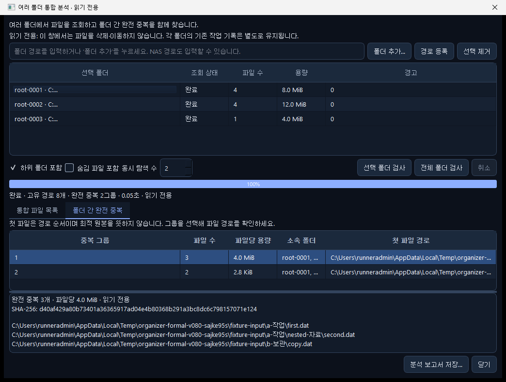
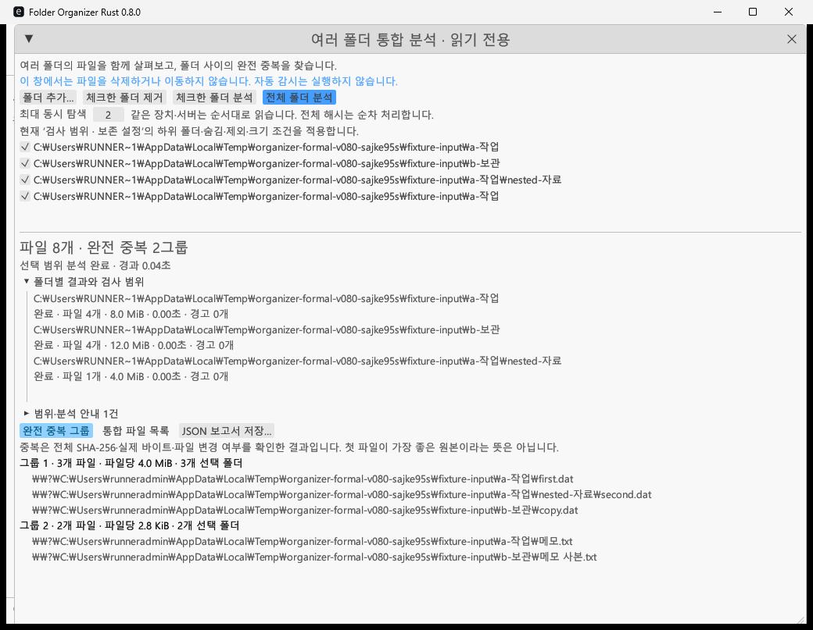

# v0.8.0 정식 배포 결과

Python·Rust Windows x64 정식 배포본을 [v0.8.0 릴리즈](https://github.com/P-JSL/Folder_Organizer/releases/tag/v0.8.0)에 공개했습니다. 다운로드 파일과 자동 업데이트 자산 이름은 유지합니다.

| 배포본 | ZIP 바이트 | 비압축 바이트 | 파일 수 |
| --- | ---: | ---: | ---: |
| Python | 57,455,396 | 129,018,920 | 249 |
| Rust | 8,662,192 | 21,367,809 | 426 |

- Python SHA-256: `fcc1362189f9b5e94fb3970c4b5f515c0152cbd2d30bee14f3ec17de57cfd246`
- Rust SHA-256: `2128f5529cc99f299c2168f345fd77c127fa040e1689a4c39d25b68a2791fec8`

실제 빌드에서 실행 파일 5개는 모두 `NotSigned`로 기록됐습니다. 공인 게시자 서명을 제공하는 배포본으로 표시하지 않습니다.

## 새 Windows 확인 결과

이미 통과한 확장 개선 검사 52건과 수정하지 않은 기능은 재실행하지 않았습니다. 새 Esc 취소·읽기 전용 화면 검증 진입점의 로컬 사례 2건을 추가 확인하고, 정식 ZIP에서 다음 Windows 경로를 확인했습니다.

| 새 확인 | 결과 |
| --- | --- |
| 260자 초과 Unicode/verbatim 경로, 겹친 루트·하드링크·128비트 파일 ID | 통과 |
| 같은 파일 ID·크기·수정 시각을 유지한 내용 변경과 실제 NTFS ChangeTime | 통과, 변경 파일은 부분 결과로 제외하고 정상 그룹 유지 |
| 독점 열린 파일의 부분 결과와 전체 해시 도중 취소 | 통과, 원본 보존·취소 후 전체 완료 표시 방지 |
| 실제 두 CLI의 전체·중첩/하드링크·목록만 조회·접근 불가·크기 조건 | 4가지 시나리오에서 생성한 정답·메타데이터·두 판의 의미 일치 |
| 실제 Python EXE의 중복·유사 연속 분석 | 다른 해시 힌트 3건 재사용, 유사 3쌍 유지, 추가 바이트 비교 읽기 0 |
| 실제 Python·Rust EXE의 새 다중 폴더 창 | 정상 worker 결과·보고서 일치, 렌더링 화면 보존, 종료 코드 각각 0 |

전체 범위는 고유 경로 8개·완전 중복 2그룹, 1 MiB 최소 크기 조건은 경로 5개·1그룹이었습니다. 접근 불가 루트가 있으면 정상 2그룹을 유지하면서 완료 상태를 `false`, 종료 코드를 2로 표시했습니다. 생성 시각은 해당 범위의 8개/5개 값을 두 판과 원래 메타데이터로 대조했습니다. 임시 원본의 파일 목록·내용·크기·수정 시각·식별자는 유지됐습니다.

## 보고된 두 실패와 재사용 범위

첫 실행에서 Windows 경로·변경 감지 사례 2건과 두 정식 ZIP 빌드는 통과했습니다. 나머지 취소 사례는 실제 코어가 사용하지 않는 `duplicates_hash` 단계를 기다리던 검사 코드 오류였습니다. 코어가 실제로 알리는 첫 `duplicates` 해시 진행에 취소하도록 수정했습니다.

새 배포 CLI 확인은 `RUNNER~1` 같은 DOS 8.3 임시 부모 경로와 정규 긴 경로를 비교하면서 실패했습니다. 검사 도구에서 부모 경로를 정규화하고 최종 파일명은 유지해 하드링크 별칭을 합치지 않도록 수정했습니다. 앱 코드는 두 보정에서 바뀌지 않았습니다.

빌드·앱·서명·버전 입력의 바이트가 동일한지와 통과한 두 함수의 소스가 그대로인지 확인한 뒤 **정식 ZIP을 재사용하고 실패한 1건만 `--exact`로 실행**했습니다. 기존 2건과 52건을 반복하지 않았습니다. 완료한 CLI·GUI 자료와 ZIP 해시를 초안 상태에서 확인한 다음 게시만 진행했습니다.

| 역할 | 소스·실행 |
| --- | --- |
| 실제 실행 파일 빌드·변경 불가능한 `v0.8.0` 태그 | `ccdbe6a2c6c59817fd807c1d3d6107992db10ff4` · [41365825550](https://github.com/P-JSL/Folder_Organizer/actions/runs/41365825550) |
| 검사 도구 보정·남은 확인 성공 | `c3c43199c231533f2b71d5f4ed20edc51fe3684d` · [41391297106](https://github.com/P-JSL/Folder_Organizer/actions/runs/41391297106) |
| 기존 ZIP 게시만 수행 | 같은 검증 소스 · [41391618033](https://github.com/P-JSL/Folder_Organizer/actions/runs/41391618033) |

검증을 재현할 때는 태그의 빌드 소스와 보정된 검사 도구 소스를 구분해야 합니다. 원래 태그는 이동하지 않았습니다. 원시 명령·stdout/stderr·종료 코드·입출력과 실행 파일 해시·이전 성공 로그·재사용 영수증·`SOURCE_CHAIN.json`은 릴리즈 첨부 [VALIDATION_RESULTS.zip](https://github.com/P-JSL/Folder_Organizer/releases/download/v0.8.0/VALIDATION_RESULTS.zip)에 포함합니다.

## 실제 정식 Windows 화면

아래 그림은 공개 ZIP에서 꺼낸 프로그램의 실제 새 창과 정상 분석 worker를 읽기 전용 검증 진입점으로 실행해 캡처한 것입니다. 임시 합성 자료를 사용했고 PrintWindow로 본문 렌더링을 확인했습니다. 모든 메뉴의 수동 조작·접근성·DPI·대량 GUI 전체를 시험했다는 뜻은 아닙니다.

Python:

Rust:

실제 NAS·물리 HDD/SSD·콜드 캐시·10만 행 GUI 성능은 이번 새 확인에 포함되지 않습니다. 과거 0.7.0의 4~6배 측정이나 Linux의 특정 매칭 개선 수치를 전체 Windows 성능으로 확대하지 않습니다.
